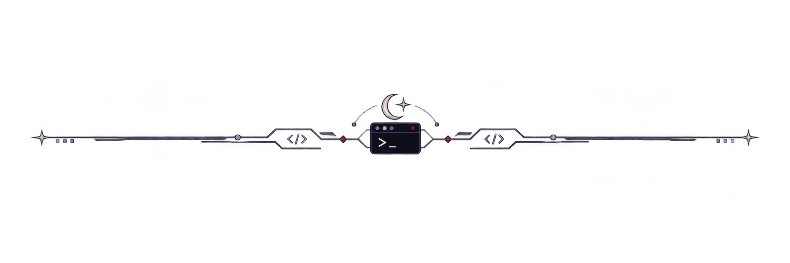

   <strong>m!khael.exe<strong> 

   Computer Science  · code · experiments · unfinished ideas 

    

        Este perfil acompanha o que estou aprendendo e construindo.      HTML, CSS e JavaScript aparecem principalmente nos meus próprios experimentos.    

    

   <a href="[https://mikhaelmk.github.io/rakumi-web/](https://mikhaelmk.github.io/rakumi-web/)">     <strong>m!khael.exe ↗<strong>   <a> 

   C++ · Git/GitHub · faculdade · projetos pessoais 

